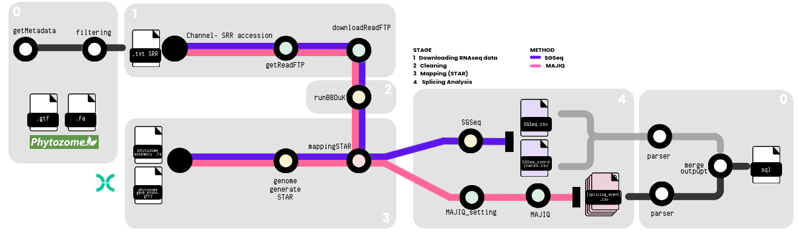

# SpliceScape

**Development branch: v2.3** (v2.2 remains the released baseline)

SpliceScape is a Nextflow pipeline for large-scale identification, quantification, and characterization of alternative splicing events from paired-end RNA-seq data.

The workflow integrates **BBDuk** (read cleaning), **STAR** (splice-aware alignment), **SGSeq** and **MAJIQ v3 / VOILA** (splicing analysis), and **SQLite** (integrated results and sample-level quality-control statistics). SpliceScape supports configurable concurrency, sample-level failure recovery, and database-backed tracking of completed and failed sample accessions.



## 1. Installation

### 1.1 Clone the repository

```bash
git clone https://github.com/labbces/SpliceScape.git
cd SpliceScape
```

### 1.2 Create the software environment

The repository provides [`envs/environment_majiqv3.yml`](envs/environment_majiqv3.yml), including Python, R/Bioconductor (SGSeq), BBDuk/BBMap, STAR, samtools, and Nextflow 25.04.8.

**Before creating the environment:** the YAML currently includes installation-specific `name` and `prefix` entries (`/Storage/progs/SpliceScape_env_p312`). Remove those two lines from your local copy of the YAML when installing outside the original development system.

```bash
# Make a local, portable copy of the supplied specification.
sed '/^name:/d; /^prefix:/d' envs/environment_majiqv3.yml > environment_majiqv3.local.yml

conda env create \
  --prefix /path/to/SpliceScape_env \
  --file environment_majiqv3.local.yml

conda activate /path/to/SpliceScape_env
```

Replace `/path/to/SpliceScape_env` with an absolute, writable installation path. Mamba may be used instead of Conda.

Check core tools:

```bash
python --version
nextflow -version
STAR --version
samtools --version
Rscript --version
```

### 1.3 Install MAJIQ v3 separately

**MAJIQ v3 is not included in the Conda YAML** and must be installed according to the MAJIQ developers' instructions. Obtain the appropriate MAJIQ license and follow the official installation procedure:

- [MAJIQ official website](https://majiq.biociphers.org/)
- [MAJIQ download and licensing](https://majiq.biociphers.org/app_download/)
- [MAJIQ installation documentation](https://biociphers.bitbucket.io/majiq-docs/getting-started-guide/installing.html)

Install MAJIQ/VOILA into the environment used to run SpliceScape and confirm that the MAJIQ command is accessible:

```bash
majiq --version
```

Keep the license file in a secure location. Its path is provided in the run-specific JSON configuration.

## 2. Input files

The pipeline requires:

1. **Genome FASTA** — uncompressed `.fa` or `.fasta`.
2. **Genome annotation** — uncompressed GFF3/GTF with gene and exon annotations suitable for the splicing tools.
3. **Sample manifest** — text file with one accession per line.

Example `samples.txt`:

```text
SRR17687198
SRR23406859
SRR12548574
```

The currently active workflow uses **`WGET_DOWNLOADER`**, which retrieves paired FASTQ files from the server configured in the JSON. Provide a URL from which files can be accessed using the sample accession, with corresponding `_1.fastq.gz` and `_2.fastq.gz` read files. **The active workflow does not download directly from NCBI based solely on SRA accessions.**

For background on reference-file preparation, see the [SpliceScape Wiki](https://github.com/labbces/SpliceScape/wiki).

## 3. JSON configuration

SpliceScape uses two complementary configurations:

- A **JSON file** supplies sample inputs, reference paths, biological parameters, output locations, cleanup options, credentials, and concurrency.
- [`reads_processing/splicescape-v2.config`](reads_processing/splicescape-v2.config) defines Nextflow executor profiles and CPU/memory allocations. Adjust its SGE queue and resources for your installation.

Create a JSON file, for example `splicescape.json`:

```json
{
  "species": "Athaliana_447",
  "species_name": "Arabidopsis thaliana",
  "reads_file": "/data/project/samples.txt",
  "genomeFASTA": "/data/genomes/Athaliana_447_TAIR10.fa",
  "genomeGFF": "/data/genomes/Athaliana_447_Araport11.gene_exons.gff3",

  "outdir": "/data/project/results",
  "backbonedir": "/data/project/reference",
  "db": "/data/project/results/db/splicescape.sqlite",

  "max_active_samples": 3,
  "threads": 12,
  "sgseq_cores": 8,
  "majiq_cores": 12,

  "bbduk": "/path/to/SpliceScape_env/bin/bbduk.sh",
  "minlength": 60,
  "trimq": 20,
  "k": 27,
  "rref": "/data/references/adapters.fa",
  "maxmem": "20g",

  "r_libs": "/path/to/R/library",

  "url": "https://example.org/rnaseq/",
  "user": "download_username",
  "password": "download_password",

  "rm_reads_scratch_raw": true,
  "rm_reads_scratch_clean": true,
  "rm_reads_inspect_bbduk_logs": false,
  "rm_mapping_inspect_bamfiles": false,
  "rm_majiq_scratch": false,

  "environment": {
    "conda_env": "/path/to/SpliceScape_env",
    "majiq_license_file": "/path/to/majiq_license.lic"
  }
}
```

**Replace the illustrative paths, URL, credentials, and filenames.** The `bbduk` field must point to the actual BBDuk executable installed on your system; its name may vary. Prefer absolute paths and ensure output and database directories are writable. Protect configuration files containing credentials, for example with `chmod 600 splicescape.json`. Do not commit credentials or license files.

### 3.1 Input and output parameters

| Parameter | Description |
|---|---|
| `species` | Reference identifier used in output names, indexing, and database records (e.g. `Athaliana_447`). |
| `species_name` | Descriptive organism name stored with the database records. |
| `reads_file` | File with one paired-end sample accession per line. |
| `genomeFASTA` | Path to uncompressed reference FASTA. |
| `genomeGFF` | Path to uncompressed reference annotation. |
| `outdir` | Main directory for outputs and intermediate files. |
| `backbonedir` | Directory for shared reference resources such as the STAR index. |
| `db` | Persistent SQLite database path. Existing database records are retained; previously processed accessions are skipped by the preflight check. |

### 3.2 Concurrency and processing resources

| Parameter | Description |
|---|---|
| `max_active_samples` | Maximum number of admitted samples in their complete processing lifecycle; default **2**. |
| `threads` | Threads passed to STAR genome indexing and alignment. |
| `sgseq_cores` | Core-count argument for SGSeq. |
| `majiq_cores` | Core-count argument for MAJIQ/VOILA stages. |

For example, `"max_active_samples": 3` allows at most three concurrently admitted samples. In the v2.3 development branch, a bounded **nonblocking admission controller** supplies the first available samples and emits one replacement after each terminal analysis outcome (including handled failures). Unlike the previous implementation, no Nextflow dataflow thread waits in `Semaphore.acquire()`. The controller closes the sample channel after all eligible samples reach terminal outcomes. Actual task scheduling is also limited by the execution profile and cluster resources. **The new controller is not yet SGE-validated; see the TODO and run the synthetic test before integration testing.**

### 3.3 BBDuk parameters

| Parameter | Description |
|---|---|
| `bbduk` | Full path to the BBDuk executable or launch script. |
| `minlength` | Minimum length retained after trimming. |
| `trimq` | Quality threshold used for read trimming. |
| `k` | K-mer size for matching the contaminant/reference FASTA. |
| `rref` | Adapter or contaminant reference FASTA. |
| `maxmem` | Java memory allocation for BBDuk, e.g. `20g`. |

### 3.4 Environment and download parameters

| Parameter | Description |
|---|---|
| `r_libs` | Directory containing the required R libraries. |
| `environment.conda_env` | Conda environment prefix; its `bin` directory is prepended to `PATH` by the launcher. |
| `environment.majiq_license_file` | Path to the MAJIQ license; the launcher exports `MAJIQ_LICENSE_FILE`. |
| `url` | Base URL for paired FASTQ download via `WGET_DOWNLOADER`. |
| `user` | Download server username. |
| `password` | Download server password. |

### 3.5 Cleanup parameters

| Parameter | Description |
|---|---|
| `rm_reads_scratch_raw` | Delete raw downloaded FASTQs after successful trimming. |
| `rm_reads_scratch_clean` | Delete cleaned FASTQs after successful mapping. |
| `rm_reads_inspect_bbduk_logs` | Control removal of BBDuk inspection logs in the applicable pipeline path. |
| `rm_mapping_inspect_bamfiles` | Delete intermediate mapped BAMs during successful sample finalization. |
| `rm_majiq_scratch` | Control removal of MAJIQ scratch files. |

All cleanup settings are JSON booleans (`true` or `false`). Retaining intermediate files is useful for troubleshooting. BBDuk and STAR summary logs must remain available until QC import has completed.

## 4. Running SpliceScape

The supported entry point is [`reads_processing/run_splicescape.py`](reads_processing/run_splicescape.py). Run these commands from the repository root.

### 4.1 SGE cluster

```bash
python3 reads_processing/run_splicescape.py \
  --params-file /absolute/path/to/splicescape.json \
  -profile sge
```

Before running, edit the SGE queue and per-process resource requests in [`reads_processing/splicescape-v2.config`](reads_processing/splicescape-v2.config) if needed. The supplied SGE profile currently uses `introns.q`.

### 4.2 Local execution

```bash
python3 reads_processing/run_splicescape.py \
  --params-file /absolute/path/to/splicescape.json \
  -profile local
```

Ensure the local machine has enough RAM and CPU capacity for STAR, SGSeq, and MAJIQ tasks.

### 4.3 Resume a previous execution

```bash
python3 reads_processing/run_splicescape.py \
  --params-file /absolute/path/to/splicescape.json \
  -profile sge \
  --resume
```

**Resume caveat:** Some intermediate files are kept outside the Nextflow work directories and may have been removed by cleanup options. Verify that required external artifacts are still present before resuming. For an independent validation run, use a fresh output directory without `--resume`.

### 4.4 Nonblocking admission controller (v2.3 development)

Run the lightweight Nextflow scheduling regression before an SGE run:

```bash
nextflow run reads_processing/test_sample_admission.nf
```

The test covers five sample outcomes (two synthetic failures), a concurrency
limit of two, exactly-once terminal notification, a single active sample, and
an empty eligible manifest. It does not execute real SGE tasks or MAJIQ.
After it passes, an SGE run with more samples than `max_active_samples`
and mixed success/failure outcomes is required before considering the new
scheduler validated.

### 4.5 Automatic skipping of previously processed samples (v2.3)

Before admitting samples for processing, SpliceScape checks the configured SQLite database (`db`). If the database contains the `sample_processing_status` table, accessions already registered as either **`SUCCESS` or `FAILED`** for the configured reference (`species`, used as `genome_version`) are **skipped automatically**. This includes failed samples: they are not retried automatically just because they previously failed.

The behavior is:

- **Database absent:** all identifiers in the manifest are eligible.
- **Database present, status table absent:** all identifiers are eligible; the table is created during database preparation. Existing biological observations are *not* automatically assigned historical statuses.
- **Database and table present:** identifiers with either terminal status are skipped; only new accessions are admitted.
- **Interrupted sample without a terminal database record:** eligible for another attempt.

The unique status key is `(sample_id, genome_version)`: an accession processed with one reference can be processed with another reference. The pipeline writes `sample_preflight.tsv` (PROCESS/SKIP for every manifest identifier) and `eligible_samples.txt` in `outdir`.

For example, a manifest of five identifiers with four already registered produces:

```text
PREFLIGHT total=5 skipped=4 eligible=1
```

The database acts as the durable processing record even if Nextflow's `.nextflow` history and `work/` cache have been deleted. The remaining new sample must still run its analysis normally. The existing biological observations are retained in the database, and the new sample results are imported incrementally.

**Important:** Do not run two SpliceScape instances against the same SQLite database concurrently. The current preflight and finalization mechanism does not provide multi-writer coordination. Use a database backup before migrating valuable databases.

## 5. Results and QC statistics

SpliceScape writes BBDuk preprocessing outputs, STAR mapping outputs, SGSeq and MAJIQ results, and an integrated SQLite database.

For samples whose **SGSeq and MAJIQ analyses and database import complete successfully**, the SQLite `sample_qc_metrics` table contains numeric BBDuk and STAR summary statistics:

```sql
SELECT sra_id, tool, metric, numeric_value, text_value
FROM sample_qc_metrics
WHERE sra_id = 'SRR17687198'
ORDER BY tool, metric;
```

QC metrics are stored using an idempotent UPSERT keyed by sample accession, genome version, tool, and metric. Re-importing the same metrics updates existing rows without duplicating them.

### 5.1 Persistent sample status and failure reasons (v2.3)

The SQLite `sample_processing_status` table stores the terminal outcome of each attempted sample. These records are inserted or updated **within the batch-level `FINALIZE_SAMPLE` process**, after analysis and import. The `POPULATE_DB_BATCH` process adds biological observations to a temporary database snapshot; `FINALIZE_SAMPLE` commits the sample statuses and publishes the updated database.

| Column | Meaning |
|---|---|
| `sample_id` | Sample accession |
| `genome_version` | Reference genome identifier |
| `status` | Terminal outcome: `SUCCESS` or `FAILED` |
| `failed_stage` | Failing pipeline stage(s), separated by semicolons when applicable |
| `exit_code` | Exit code(s) for failed stages |
| `reason` | Human-readable failure explanation |
| `updated_at` | Timestamp of last status update |

To examine sample processing history:

```bash
sqlite3 /path/to/splicescape.sqlite \
  "SELECT sample_id, genome_version, status, failed_stage, exit_code, reason, updated_at
   FROM sample_processing_status
   ORDER BY genome_version, sample_id;"
```

To list only failed samples:

```sql
SELECT sample_id, genome_version, failed_stage, exit_code, reason
FROM sample_processing_status
WHERE status = 'FAILED'
ORDER BY updated_at DESC;
```

Example for a sample that fails in two parallel MAJIQ stages:

```text
sample_id:     SRR26589537
status:        FAILED
failed_stage:  MAJIQ_PSI;MAJIQ_SG_COVERAGE
exit_code:     97;97
reason:        MAJIQ_PSI(exit=97);MAJIQ_SG_COVERAGE(exit=97)
```

Here `97` is the deliberate failure-injection exit code used for testing, not a normal MAJIQ error code. To retry a terminally failed sample, its status must first be explicitly cleared under a controlled retry procedure; simply including the accession in a later manifest will **not** rerun it. Do not delete status records casually if the sample has associated biological observations.

The run-specific `sample_status.txt` reports the outcomes of **eligible samples in that run**, whereas `sample_processing_status` maintains the persistent history across runs.

## 6. Failure handling and known limitations

The v2.3 development branch has sample-level failure reporting for `WGET_DOWNLOADER`, `ALTERNATIVE_RUN_BBDUK`, `MAPPING_STAR`, `SGSEQ`, `MAJIQ_SJ`, `MAJIQ_BUILD`, `MAJIQ_PSI`, `MAJIQ_SG_COVERAGE`, and `MAJIQ_VOILA_MODULIZE`. A failed stage records its exit code and reason; the affected sample is excluded from biological import while other samples continue.

Controlled SGE failure-injection tests validated the four intermediate MAJIQ stages (including simultaneous PSI and SG coverage failures). Subsequent database tests validated persistent status records, database-based skipping after removing Nextflow caches, and incremental import with zero cross-sample summary mismatches across 129,603 junction summary rows.

These results do not establish recovery from abrupt process termination before a status file is written, scheduler-level failures, shared reference-step errors, or failures in `POPULATE_DB_BATCH` / `FINALIZE_SAMPLE` themselves. The current admission semaphore is still blocking and requires redesign. See [`reads_processing/TODO.md`](reads_processing/TODO.md).

## 7. Documentation

- [SpliceScape Wiki](https://github.com/labbces/SpliceScape/wiki)
- [MAJIQ documentation](https://biociphers.bitbucket.io/majiq-docs/)
- [MAJIQ download and licensing](https://majiq.biociphers.org/app_download/)


### v2.3 production hardening (experimental; not a streaming importer yet)

The Python launcher now acquires a nonblocking advisory lock next to the
configured SQLite database (`<db>.splicescape.lock`) for the **entire**
preflight, analysis and import lifecycle. Use
`python3 reads_processing/run_splicescape.py --params-file ... -profile sge -resume`
for coordinated runs. A second launcher targeting the same canonical database
path exits with code 73. Do not delete the lock file while a run is active.
A direct `nextflow run` bypasses this launcher guard; separate hosts must
share correct filesystem advisory-lock semantics.

Each run also writes a distinct per-sample status journal under
`<outdir>/run_journals/<run-id>/`. A record with
`ANALYSIS_COMPLETE` means both analytical branches finished; it **does not**
mean the biological observations were imported. Database `SUCCESS` is
recorded only during `FINALIZE_SAMPLE`. Inspect pending records without
altering the database:

```bash
python3 reads_processing/bin/inspect_run_journals.py \
  --outdir /path/to/results --db /path/to/results.sqlite
```

New safeguards can be tested independently of real data:

```bash
python3 -m unittest discover -s reads_processing/tests -p 'test_phase1_safety.py'
nextflow run reads_processing/test_sample_journal.nf
```

**Important:** The current v2.3 workflow still imports and finalizes once
at the end of a run. These journals are a recovery *audit trail*, not a
persistent work queue with automatic re-import. Streaming micro-batch
imports, crash-safe transaction boundaries for existing parsers, and
production-scale performance benchmarks remain to be implemented and tested.


### Experimental offline micro-batch SQLite merger (not production enabled)

\`reads_processing/bin/incremental_sqlite_writer.py\` is an **isolated
prototype**, not connected to the Nextflow workflow. The existing
\`POPULATE_DB_BATCH\` and \`FINALIZE_SAMPLE\` processes remain the default.
Its purpose is to test transaction boundaries, re-import protection,
sample-specific QC and junction aggregates before changing scheduling.

It accepts a TSV with \`sample_id\` and \`stage_db\` columns, each \`stage_db\`
being an independently prepared **one-sample** SQLite database containing
MAJIQ, SGSeq and QC results. Staging DBs must not contain previous or other
samples, and the merger must only target a disposable **copy** of a database
on reliable local storage. Its command requires an explicit experimental
flag:

\`\`\`bash
python3 reads_processing/bin/incremental_sqlite_writer.py \
  --experimental \
  --db /local/scratch/test_copy.sqlite \
  --genome-version Athaliana_447 \
  --manifest /local/scratch/staging_manifest.tsv \
  --batch-size 20
\`\`\`

Run the synthetic rollback/aggregate/duplicate tests first:

\`\`\`bash
python3 -m unittest discover -s reads_processing/tests \
  -p 'test_incremental_sqlite_writer.py'
\`\`\`

**Do not use this prototype on the production database.** Transaction
correctness, results-equivalence with the original parser, global event
annotation handling, shared-filesystem behavior, and the creation of
single-sample staging DBs from live pipeline outputs have not yet been
validated. The prototype commits each micro-batch atomically but does not
yet implement durable work-queue ingestion, failed-sample record commits,
or streaming Nextflow admission/import coordination.
